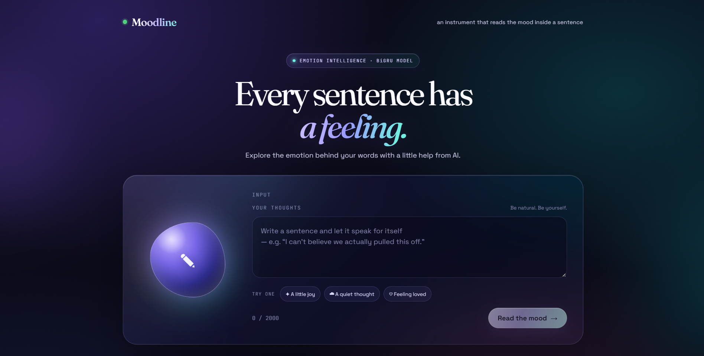
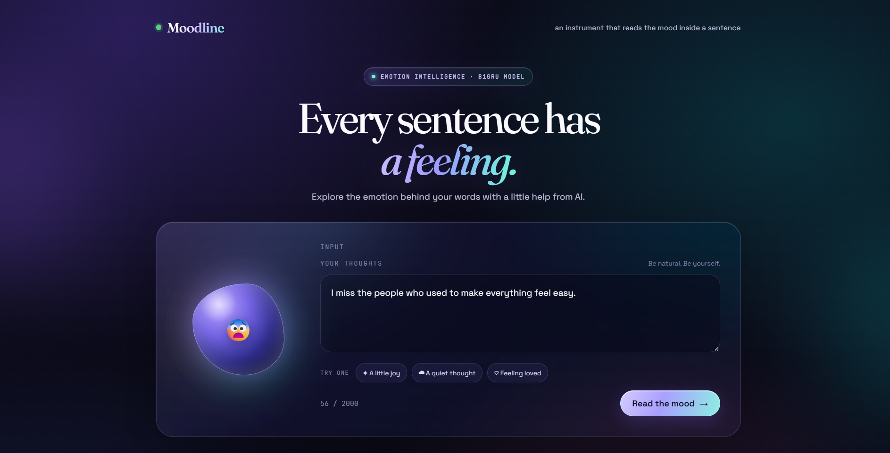
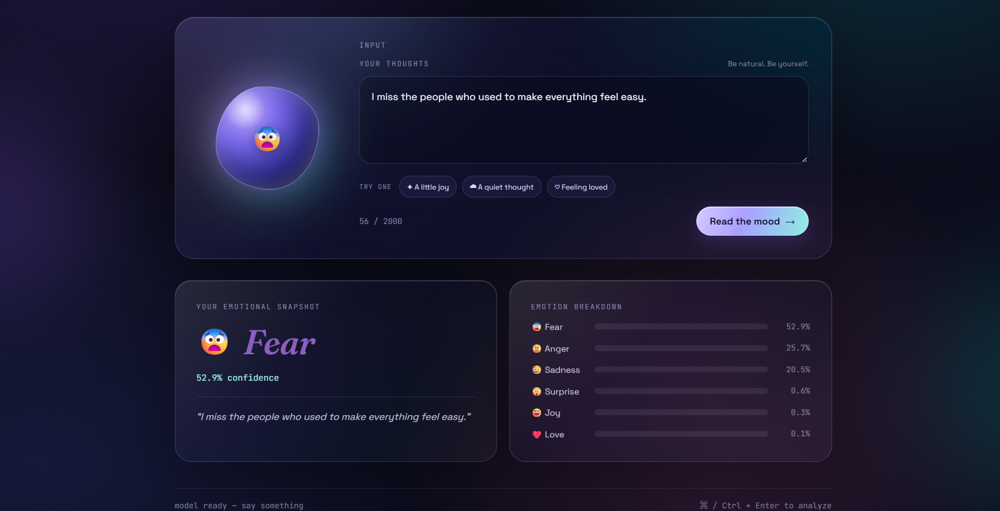

<h1 align="center">Moodline – Emotion Classification Using Deep Learning</h1>
<!-- PROJECT SCREENSHOTS -->

<p align="center">
  
  
  
</p>


<p align="center">
  <b>An AI-powered application that understands the emotions behind human text using a Bidirectional GRU model.</b>
</p>

---

## 📌 Project Overview

Moodline is a Deep Learning and Natural Language Processing (NLP) project designed to identify emotions from text.

The application takes a sentence or a paragraph as input and predicts the emotion expressed in the text using an advanced Bidirectional Gated Recurrent Unit (BiGRU) neural network.

Unlike traditional text classification approaches, this project uses recurrent neural networks to understand the sequence and contextual relationships between words.

The model classifies text into six different emotional categories:

- 😊 Joy
- 😢 Sadness
- ❤️ Love
- 😠 Anger
- 😨 Fear
- 😲 Surprise

The project also provides an interactive web interface where users can enter text and instantly see the predicted emotion along with its confidence score and probability distribution.

---

## 🎯 Project Objectives

- Build an emotion classification system using Deep Learning.
- Understand sequential relationships in textual data.
- Compare Simple RNN, LSTM, and GRU architectures.
- Implement an advanced Bidirectional GRU model.
- Perform text preprocessing and tokenization.
- Deploy the trained model using FastAPI.
- Develop an interactive web application for real-time predictions.

---

## 📊 Dataset

This project uses the **Emotion Dataset** from Hugging Face.

Dataset: [dair-ai/emotion](https://huggingface.co/datasets/dair-ai/emotion)

The dataset contains English text samples labeled with six different emotions.

The dataset is divided into training and testing sets.

---

## 🧠 Deep Learning Models

During this project, multiple recurrent neural network architectures were implemented and compared.

| Model | Description |
|---|---|
| Simple RNN | Basic recurrent neural network |
| LSTM | Long Short-Term Memory network |
| GRU | Gated Recurrent Unit |
| BiGRU | Bidirectional Gated Recurrent Unit |

### Final Model: Bidirectional GRU

The final model uses a stacked Bidirectional GRU architecture.

**Model Architecture:**

1. Embedding Layer – Converts words into 300-dimensional vectors.
2. Bidirectional GRU Layer – 128 units with sequence output.
3. Dropout Layer – 0.5 dropout rate.
4. Bidirectional GRU Layer – 64 units.
5. Dropout Layer – 0.5 dropout rate.
6. Dense Layer – 6 neurons with Softmax activation.

The Softmax activation function generates probability scores for all six emotion categories.

---

## ⚙️ Data Preprocessing

The following preprocessing steps are performed:

- Convert text into lowercase.
- Remove apostrophes.
- Remove special characters and punctuation.
- Remove unnecessary spaces.
- Convert words into numerical sequences using Tokenizer.
- Limit vocabulary size to 10,000 words.
- Apply padding and truncation.
- Set maximum sequence length to 50.

These steps ensure that the input text is in the same format used during model training.

---

## 🛠️ Technologies Used

| Category | Technologies |
|---|---|
| Programming Language | Python |
| Deep Learning | TensorFlow, Keras |
| NLP | Tokenizer, Text Preprocessing |
| Neural Networks | RNN, LSTM, GRU, BiGRU |
| Data Processing | NumPy, Pandas |
| Visualization | Matplotlib, Seaborn |
| Dataset | Hugging Face Datasets |
| Backend | FastAPI |
| Frontend | HTML, CSS, JavaScript |
| Model Storage | Keras, Pickle |

---

## 🚀 Application Features

- Real-time emotion prediction.
- Six emotion classification categories.
- Confidence score for predicted emotions.
- Probability breakdown for all six emotions.
- Interactive and responsive user interface.
- Example sentences for quick testing.
- FastAPI backend integration.
- Model health-check endpoint.

---

## 📂 Project Structure

```text
Deep-Learning-Project/
│
├── Artifacts/
│   ├── BiGRU_Model.keras
│   └── tokenizer.pkl
│
├── images/
│   ├── DL_1.png
│   ├── DL_2.png
│   └── DL_3.png
│
├── static/
│   ├── index.html
│   ├── style.css
│   └── script.js
│
├── final_clean.ipynb
├── main.py
├── requirements.txt
├── runtime.txt
└── README.md
```

---

## 💻 Installation and Setup

Follow these steps to run the project locally.

### 1. Clone the Repository

```bash
git clone YOUR_GITHUB_REPOSITORY_URL
```

### 2. Navigate to the Project Folder

```bash
cd Deep-Learning-Project
```

### 3. Create a Virtual Environment

```bash
python -m venv venv
```

### 4. Activate the Virtual Environment

For Windows:

```bash
venv\Scripts\activate
```

For macOS/Linux:

```bash
source venv/bin/activate
```

### 5. Install Dependencies

```bash
pip install -r requirements.txt
```

### 6. Run the Application

```bash
uvicorn main:app --reload
```

### 7. Open the Application

Open your browser and visit:

```text
http://127.0.0.1:8000
```

You can now enter any sentence and analyze its emotion.

---

## 🔗 API Endpoints

The project uses FastAPI to handle requests and generate predictions.

| Method | Endpoint | Description |
|---|---|---|
| GET | `/` | Opens the web application |
| GET | `/health` | Checks server and model status |
| POST | `/predict` | Predicts the emotion of input text |
| GET | `/docs` | Opens interactive API documentation |

### Example Prediction Request

**POST /predict**

```json
{
  "text": "I am extremely happy today!"
}
```

### Example Response

```json
{
  "text": "I am extremely happy today!",
  "predicted_emotion": "joy",
  "confidence": 0.95,
  "all_probabilites": {
    "sadness": 0.01,
    "joy": 0.95,
    "love": 0.02,
    "anger": 0.005,
    "fear": 0.005,
    "surprise": 0.01
  }
}
```

*Note: The probability values above are illustrative examples.*

---

## 📈 Model Evaluation

The project follows a comparative approach to evaluate different recurrent neural network architectures.

The implemented models are:

- Simple RNN
- Standard LSTM
- Standard GRU
- Advanced Bidirectional GRU

The models are evaluated using test loss and accuracy.

A confusion matrix is also used to understand the classification performance of the final BiGRU model across the six emotion categories.

---

## 🔮 Future Improvements

- Improve prediction accuracy through hyperparameter tuning.
- Experiment with Transformer-based architectures.
- Add multilingual emotion classification.
- Support longer text inputs.
- Improve model performance on similar emotional expressions.
- Deploy the application using a cloud hosting platform.

---

## 👨‍💻 Author

**Shreyas Patil**

Deep Learning | Machine Learning | Natural Language Processing | Python

---

<p align="center">
  <b>Built with Python, TensorFlow, Keras and FastAPI ❤️</b>
</p>
